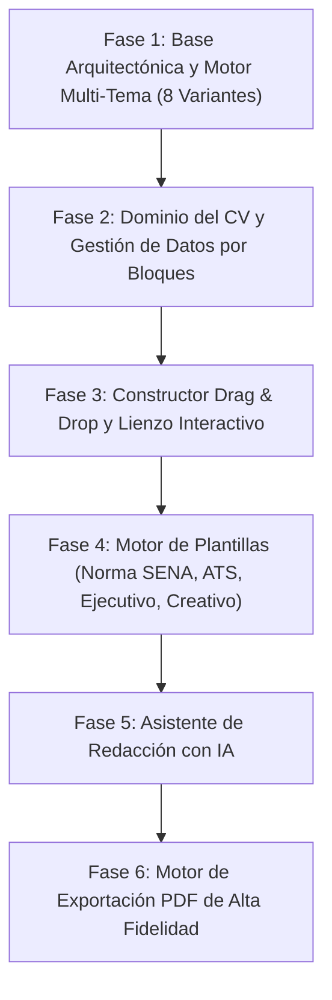

# Cronograma de Funcionalidad y Construcción — Generador de Hojas de Vida

Este documento define la arquitectura por funcionalidades, el desglose de módulos y el cronograma de construcción incremental del proyecto, garantizando el cumplimiento estricto de las **5 Reglas Inquebrantables** definidas en `AGENTS.md`.

> [!IMPORTANT]
> Cada fase está diseñada para producir incrementos funcionales completos sin componentes monolíticos, manteniendo la separación total entre lógica (`hooks/`, `services/`, `utils/`) y presentación (`components/`), y aplicando el sistema de **8 variantes visuales** (`ArtPop`, `Brutalismo`, `Minimalismo`, `Memphis` × `Claro/Oscuro`).

---

## 1. Mapa de Fases de Construcción



---

## 2. Estructura de Directorios por Funcionalidades (`src/features/`)

```text
src/
├── app/                          # Capa delgada de enrutamiento y composición (Next.js App Router)
├── shared/                       # Elementos verdaderamente transversales (DRY)
│   ├── components/ui/            # Primitivos atómicos (Button, Card, Input, Badge, Modal, Tooltip)
│   ├── hooks/                    # Hooks genéricos (useLocalStorage, useDebounce, useMediaQuery)
│   ├── types/                    # Tipos globales compartidos
│   └── utils/                    # Utilidades puras transversales (cn, formatters, idGenerator)
└── features/                     # Módulos de negocio independientes
    ├── theme-engine/             # Estilo visual (ArtPop, Brutalismo, Minimalismo, Memphis) + Light/Dark
    ├── cv-document/              # Modelo de datos del CV, bloques, estado global y persistencia
    ├── block-editor/             # Formularios atómicos de edición por tipo de bloque
    ├── canvas-dnd/               # Sistema Drag & Drop para reordenar/mover bloques en columnas/secciones
    ├── cv-templates/             # Diseños de salida (Formato SENA, ATS Estándar, Moderno, Creativo)
    ├── ai-assistant/             # Asistente de IA para redactar perfil, logros, habilidades y corrección
    └── pdf-export/               # Previsualización paginada A4/Carta y generación de PDF descargable
```

---

## 3. Desglose Detallado por Fases y Entregables

| Fase | Nombre de la Fase | Feature Principal | Componentes Atómicos (`components/`) | Lógica Desacoplada (`hooks/`, `services/`, `utils/`) | Entregable Verificable |
| :--- | :--- | :--- | :--- | :--- | :--- |
| **Fase 1** | **Cimientos, Primitivos UI y Motor Multi-Tema** | `theme-engine` & `shared/ui` | `ThemeStyleSelector`, `ColorModeToggle`, `ThemePreviewBadge`, primitivos `Button`, `Card`, `Input`, `Select`, `Tabs`, `Panel` | `useThemeEngine`, `themeTokens.config.ts`, persistencia de tema y atributos `data-style` / `data-mode` en `<html>` | Cambio instantáneo en vivo entre **ArtPop, Brutalismo, Minimalismo y Memphis** en modo **Claro y Oscuro** en toda la interfaz. |
| **Fase 2** | **Modelo de Dominio del CV y Formularios Atómicos** | `cv-document` & `block-editor` | `PersonalInfoForm`, `ExperienceItemForm`, `EducationItemForm`, `SkillTagInput`, `CertificationItemForm`, `ReferenceItemForm`, `CustomBlockForm` | `useCvDocument`, `useBlockCrud`, `cvValidation.utils.ts`, `cvStorage.service.ts` | Creación, edición, validación y guardado automático de todos los bloques de información de la hoja de vida sin duplicar formularios. |
| **Fase 3** | **Constructor Visual Drag & Drop por Bloques** | `canvas-dnd` | `DraggableBlockCard`, `DropZoneColumn`, `BlockVisibilityToggle`, `BlockActionToolbar`, `AddBlockCatalogModal`, `LayoutStructurePicker` | `useBlockDragAndDrop`, `useCanvasLayout`, `reorderBlocks.utils.ts` | Arrastrar y soltar bloques para cambiar su orden, moverlos entre sección principal y barra lateral, ocultar/mostrar bloques y añadir secciones personalizadas. |
| **Fase 4** | **Catálogo de Formatos y Diseño Norma SENA** | `cv-templates` | `TemplateSelectorBar`, `SenaOfficialTemplate`, `AtsClassicTemplate`, `ExecutiveTwoColumnTemplate`, `CreativeModularTemplate` | `useTemplateRenderer`, `senaFormatRules.utils.ts`, `templateMapper.utils.ts` | Renderizado en tiempo real del CV en múltiples formatos, incluyendo el **formato exigido por las normas del SENA** (estructura institucional, datos personales, formación, experiencia certificada y soportes). |
| **Fase 5** | **Asistente Inteligente de Redacción (IA)** | `ai-assistant` | `AiActionTriggerButton`, `AiSuggestionPopover`, `AiProfileGeneratorModal`, `AiBulletImproverList`, `AiToneSelector` | `useAiContentAssistant`, `aiPromptBuilder.utils.ts`, `aiCompletion.service.ts` (Route Handler `/api/ai`) | Sugerencia y mejora de perfiles profesionales, redacción de logros con verbos de acción, adaptación al cargo objetivo y sugerencia de habilidades. |
| **Fase 6** | **Previsualización Paginada y Descarga PDF** | `pdf-export` | `PaperCanvasViewport`, `ZoomControlsBar`, `PageBreakIndicator`, `ExportPdfButton`, `ExportSettingsModal` | `usePdfExport`, `useCanvasZoom`, `pdfGenerator.service.ts`, `printStyles.utils.ts` | Descarga limpia en PDF vectorial (tamaño Carta / A4) respetando márgenes, saltos de página y tipografías del diseño elegido (independiente del tema de la app). |

---

## 4. Especificación del Sistema Multi-Estilo (Regla #5)

La interfaz de la aplicación (el estudio de edición) se controla mediante dos ejes ortogonales en el elemento raíz (`data-style="artpop|brutalism|minimalist|memphis"` y `data-mode="light|dark"`):

1. **ArtPop (Pop Art)**:
   - *Light*: Fondo crema cálido con trama sutil de semitonos (`radial-gradient`), acentos magenta/cian/amarillo vibrante, bordes negros definidos y sombras desplazadas de color.
   - *Dark*: Fondo azul noche profundo con semitonos contrastados, acentos neón pop (fucsia, amarillo eléctrico, cian brillante) y bordes marcados.
2. **Brutalismo (Neo-Brutalism)**:
   - *Light*: Fondo crudo/papel o amarillo ácido suave, bordes sólidos de `3px solid #000`, esquinas rectas (`0px`), sombras duras (`4px 4px 0px #000`) y tipografía grotesca/monoespaciada audaz.
   - *Dark*: Fondo carbón (`#121212`), bordes blancos o verde lima de `3px`, sombras duras contrastadas (`4px 4px 0px #a3e635`) y alto contraste geométrico.
3. **Minimalismo (Minimalist)**:
   - *Light*: Blanco puro y grises piedra ultraclaros, bordes de `1px` muy sutiles, radios suaves (`8px`), sombras difusas casi imperceptibles y foco total en la tipografía.
   - *Dark*: Negro obsidiana y grises zinc oscuros, bordes translúcidos (`rgba(255,255,255,0.08)`), contraste descansado y estética limpia.
4. **Memphis (Memphis Design)**:
   - *Light*: Fondos pastel (menta, lavanda, durazno suave) combinados con acentos geométricos coral, azul cobalto y amarillo sol, bordes redondeados asimétricos y patrones decorativos.
   - *Dark*: Fondo púrpura/índigo oscuro profundo con acentos pastel vibrantes (turquesa, coral vivo, amarillo pastel), bordes dobles/decorativos y geometría expresiva.

> [!NOTE]
> El **documento de la Hoja de Vida** dentro del lienzo conserva siempre su fidelidad de impresión (por ejemplo, sobrio y normativo en el formato SENA), mientras que toda la aplicación alrededor se transforma con los 8 temas.

